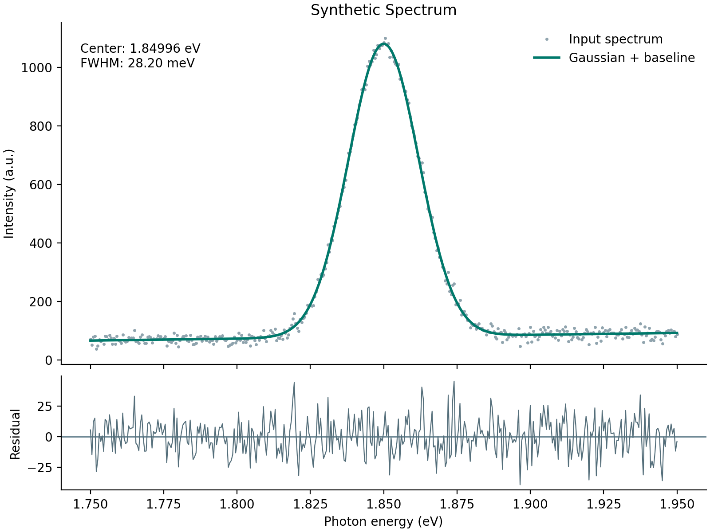

# Spectroscopy Analysis

Reproducible Python analysis of one isolated emission peak: center, linewidth, local uncertainty estimates, and residual diagnostics.

**Educational prototype. All supplied spectra are synthetic, not experimental measurements or published research. Initial code and documentation generated with ChatGPT assistance. Review and understand the implementation before presenting it as your portfolio work.**



## Run the example

Locally tested with Python 3.12.14 and the pinned dependencies:

```bash
python -m venv .venv
# macOS/Linux
source .venv/bin/activate
# Windows PowerShell instead: .venv\Scripts\Activate.ps1
pip install -r requirements.txt
python spectroscopy.py demo
python spectroscopy.py fit data/synthetic_spectrum.csv
python -m unittest discover -s tests -v
```

The demo uses seed 42. Outputs include PNG and SVG figures, a fitted-curve CSV with residuals, and a JSON summary. Existing outputs in the selected output directory are overwritten.

## Example results

| Quantity | Simulation truth | Recovered |
| --- | ---: | ---: |
| Center | 1.85000 eV | 1.84996 eV |
| FWHM | 28.25784 meV | 28.19918 meV |

Approximate standard errors: 0.00003750 eV for center and 0.09404 meV for FWHM. Residual RMSE: 14.21720 a.u.; simulated noise standard deviation: 15 a.u. These are different statistical quantities. Truth and provenance are saved in `data/synthetic_truth.json`.

## Analyze your data

Supply a CSV with `energy_eV,intensity` column headers and at least 12 finite samples. Select a window containing one complete peak and baseline on both sides.

```bash
python spectroscopy.py fit my_spectrum.csv --out my_results
```

Rows are sorted by energy. Duplicate energies, nonfinite inputs, and constant intensities are rejected. The input intensity convention must be consistent across comparisons. Converting wavelength-domain spectral density to energy-domain spectral density requires an appropriate Jacobian; this tool does not perform that conversion.

## Scientific model

The fitted model is `A exp[-(E-E0)^2/(2 sigma^2)] + b + m(E-mean(E))`, with `FWHM = 2 sqrt(2 ln 2) sigma`. The peak amplitude and width are constrained positive. SciPy nonlinear least squares fits the parameters without weights.

Assumptions: one positive Gaussian peak, linear baseline, independent constant-variance noise, adequate sampling, and a sufficiently wide fit window. Covariance standard errors are local approximations conditional on these assumptions. They exclude calibration error, instrument response, and other systematic uncertainties. Bounds and parameter correlations can invalidate them. Truncated peaks and parameters near bounds trigger warnings.

Limitations: no overlapping-peak decomposition, Lorentzian/Voigt comparison, Poisson weighting, cosmic-ray rejection, instrument-response deconvolution, or bootstrap coverage study. Structured residuals indicate model inadequacy. A Gaussian fit does not identify an exciton, trion, defect, material, or brightening mechanism. Do not infer a lifetime from this Gaussian linewidth.

## Validation and files

Four local tests pass: noisy peak recovery, reversed-input invariance, invalid input rejection, and truncated-peak warning. The complete demonstration also runs locally. GitHub Actions configuration is included but has not yet run on GitHub. These checks do not establish validity for arbitrary experimental spectra.

- `spectroscopy.py`: simulation, CSV validation, fitting, and plotting CLI.
- `tests/`: scientific recovery and validation tests.
- `data/`: synthetic inputs and ground truth.
- `results/`: example fit, residuals, and figures.
- `.github/workflows/tests.yml`: automated test workflow.
- `PORTFOLIO_ROADMAP.md`: proposed next projects and contribution guidance.
- `PUBLISH.md`: GitHub setup instructions.

No license has been selected. Choose appropriate reuse terms before inviting reuse. No affiliations, publications, experimental findings, or independent authorship are claimed.
